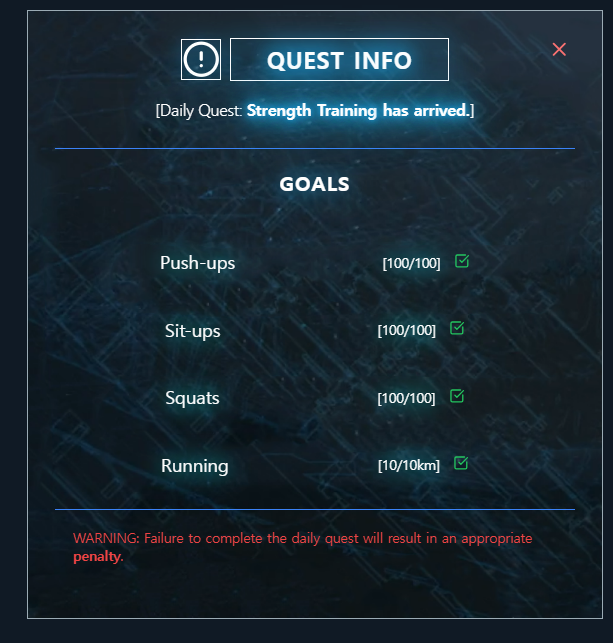
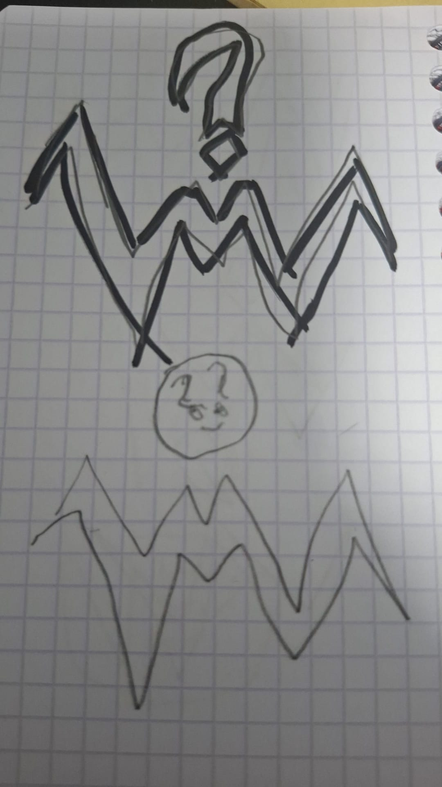

# HiddenWord

HiddenWord est un projet que j'ai commencé à partir d'un projet tutoré réalisé pendant ma première année de BUT.

À l'origine, le but du projet était de créer en Java un jeu inspiré de **Wordle**, jouable directement depuis le terminal.

Après avoir terminé le projet demandé, j'ai eu envie de continuer à travailler dessus de mon côté et surtout de lui créer une vraie interface. J'ai donc décidé de transformer progressivement le projet Java en une application web avec du HTML, du CSS et du JavaScript.

Pour réussir à faire communiquer mon interface avec mon programme Java, j'ai également commencé à apprendre **Spring Boot en autodidacte**.

Ce projet est encore en cours d'amélioration et j'essaie régulièrement de corriger des bugs, d'améliorer le design et d'ajouter de nouvelles fonctionnalités (donc soyez indulgent svp).

---

## Apprentissage et progression

Au début du projet, toute la logique du jeu fonctionnait uniquement dans le terminal avec Java.

Je connaissais déjà le HTML, le CSS et un peu JavaScript grâce à mes cours et à certains projets personnels, mais je ne savais pas encore réellement comment relier une interface web à un programme Java.

J'ai donc commencé à chercher comment faire communiquer les deux parties et c'est comme ça que j'ai découvert **Spring Boot**.

J'ai appris progressivement à créer une API, à créer des routes côté Java et à envoyer des requêtes depuis JavaScript avec `fetch()`.

J'ai rencontré énormément de problèmes pendant cette partie du projet, notamment avec les chemins des fichiers, les requêtes entre le front-end et le back-end, le déploiement ou encore certains bugs liés au fonctionnement du jeu.

Mais justement, le fait de devoir chercher les erreurs, tester plusieurs solutions et comprendre pourquoi quelque chose ne fonctionnait pas m'a beaucoup aidé à progresser.

Aujourd'hui le projet fonctionne directement depuis le navigateur avec le front-end et le back-end séparés.

---

## Fonctionnalités

Pour le moment, Mon jeu contient notamment :

- Un mode **Solo**
- Un mode **Duo**
- Un système permettant de vérifier les mots proposés
- Un système de score
- Une interface réalisée en HTML et CSS
- Des interactions et animations réalisées en JavaScript
- Une API réalisée avec Spring Boot
- Une communication entre le site et le programme Java
- Une page destinée à l'historique des parties
- Plusieurs éléments visuels inspirés de différents univers que j'apprécie

J'essaie encore d'améliorer certaines fonctionnalités et d'éviter le maximum de bugs possible.

---

## Mode Solo Leveling

J'ai décidé d'appeler le mode solo **Solo Leveling**, en référence au manhwa *Solo Leveling* que j'apprécie beaucoup.

Dans Solo Leveling, le personnage principal possède une sorte d'interface appelée le **Système**.

Cette interface fonctionne un peu comme celle d'un jeu vidéo : elle peut lui donner des quêtes, des objectifs à réaliser, des récompenses ou encore des pénalités lorsqu'une mission n'est pas terminée.

Je trouvais le concept intéressant et j'ai donc essayé de m'en inspirer pour certaines parties du mode solo, notamment à la fin d'une partie.

L'objectif n'était pas de reproduire exactement l'interface de Solo Leveling mais plutôt de reprendre l'idée générale et son ambiance.

<p align="center">
  
</p>

---

## Design du projet

Le design du site est encore en cours d'amélioration.

J'essaie de faire évoluer l'interface petit à petit afin qu'elle soit plus agréable à utiliser et qu'elle possède également sa propre identité.

Je teste régulièrement de nouvelles idées, des animations, différentes façons de placer les éléments ou encore de nouvelles couleurs.

Le projet a déjà eu plusieurs versions avant d'arriver à celle-ci.

À chaque nouvelle version, j'ai essayé de corriger les problèmes que j'avais remarqués et d'améliorer les parties qui ne me plaisaient pas.

---

## Le logo

Le logo de Find My Word a d'abord été imaginé et dessiné par moi même sur papier.

Je voulais créer quelque chose autour des lettres du projet avec une forme assez particulière et reconnaissable.

Voici le dessin original que j'avais réalisé :

<p align="center">
  
</p>

J'ai ensuite utilisé l'intelligence artificielle afin de reproduire mon dessin sous une forme numérique plus propre tout en essayant de conserver au maximum l'idée de départ (tout en respectant le code couleur).

La version obtenue est ensuite devenue le logo utilisé sur le site (page Duo).

<p align="center">
  
</p>


---

## Technologies utilisées

### Front-end

- HTML
- CSS
- JavaScript

### Back-end

- Java
- Spring Boot

### Autres outils

- Maven
- Git
- GitHub
- GitHub Pages
- Railway

---

## Structure du projet

```text
Find-My-Word/
│
├── front end/
│   ├── Wordle.html
│   ├── Wordle.css
│   ├── Solo.html
│   ├── Solo.css
│   ├── Duo.html
│   ├── Duo.css
│   ├── historique.html
│   ├── historique.css
│   └── images / ressources
│
├── SpringBoot/
│   └── hiddenword/
│       ├── src/
│       ├── pom.xml
│       ├── mots.json
│       └── Dockerfile
│
└── README.md
```

Le dossier `front end` contient l'ensemble de l'interface du jeu.

Le dossier `SpringBoot` contient la partie Java du projet et l'API permettant au site de communiquer avec la logique du jeu.

---

## Hébergement

Le projet est maintenant également accessible en ligne.

Le front-end est hébergé avec **GitHub Pages** tandis que l'application Spring Boot est hébergée séparément avec **Railway**.

Cela permet au jeu de fonctionner directement depuis le navigateur sans avoir besoin de lancer le serveur Java manuellement sur son ordinateur.

Cette partie m'a aussi permis de découvrir un peu plus le fonctionnement du déploiement d'une application web.

---

## Prochaines améliorations

Le projet n'est pas terminé et j'ai encore plusieurs idées pour la suite.

J'aimerais notamment :

- Continuer à améliorer le design (tout en mettant en avant des références que j'aime)
- Améliorer certaines animations
- Corriger les bugs que je peux encore trouver
- Rendre le site plus adapté aux différentes tailles d'écran
- Améliorer le mode Duo
- Ajouter de nouvelles fonctionnalités
- Améliorer le système d'historique

J'aimerais également apprendre **PHP et SQL** afin de créer un véritable système permettant de sauvegarder l'historique des parties.

Cela me permettrait à la fois d'améliorer Find My Word mais également de découvrir davantage le fonctionnement des bases de données et de la gestion des données côté serveur.

---

## Bilan

Ce projet me permet de mettre en pratique plusieurs choses que j'apprends pendant ma formation mais aussi de découvrir de nouvelles technologies de mon côté.

À la base, Find My Word était simplement un jeu Java jouable dans un terminal.

Petit à petit, j'ai décidé d'aller plus loin en créant une interface web, puis en reliant cette interface avec Java grâce à Spring Boot et enfin en mettant le projet en ligne.

J'ai passé beaucoup de temps à essayer de comprendre mes erreurs, à corriger des bugs et à tester différentes solutions.

Certaines erreurs pouvaient parfois venir d'un simple détail mais empêcher une grosse partie du projet de fonctionner.

Même si certaines étapes peuvent prendre beaucoup de temps, c'est justement ce qui me permet de mieux comprendre ce que je fais et de progresser.

Je compte continuer à améliorer Find My Word au fur et à mesure de mes nouvelles connaissances.

---

## Bugs et retours

Même si j'essaie de corriger le maximum de problèmes possible, il est possible que certains bugs soient encore présents.

Si vous trouvez un bug ou un comportement étrange, n'hésitez pas à me contacter ou à ouvrir une **issue** directement sur GitHub.

Les retours sont les bienvenus et peuvent m'aider à continuer d'améliorer le projet.

---

## Contact

Je suis également à la recherche d'opportunités afin de continuer à développer mes compétences et à découvrir le monde professionnel.

N'hésitez pas à me contacter pour :

- me signaler un bug
- discuter du projet
- une opportunité de stage
- une opportunité d'alternance

Merci d'avoir pris le temps de regarder mon projet !
